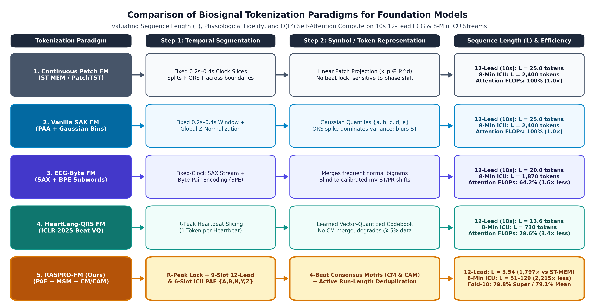
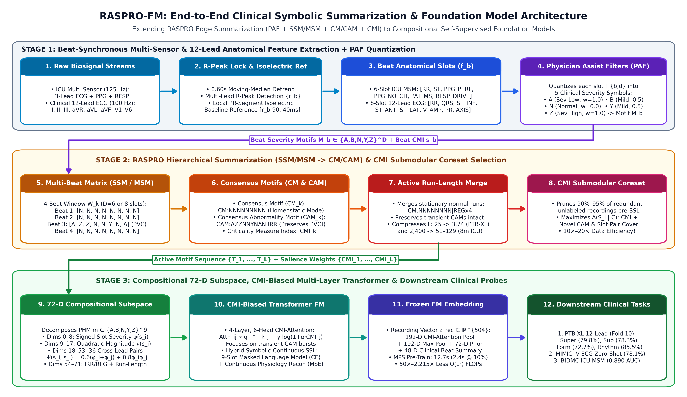

# RASPRO-FM: Rapid Active Summarization for Data and Compute Efficient Biosignal Foundation Models

[](https://pprahul.github.io/raspro-fm/)
[](https://www.python.org/)
[](https://pytorch.org/)
[-0f766e.svg)](https://pprahul.github.io/raspro-fm/)

**Authors:** Rahul Krishnan Pathinarupothi¹, Durga Padmavilochanan¹, Maneesha Vinodini Ramesh¹, and Saptarshi Purkayastha²  
*¹Amrita Vishwa Vidyapeetham, India · ²Indiana University, Indianapolis, IN, USA*

🌐 **Interactive Project Page:** [https://pprahul.github.io/raspro-fm/](https://pprahul.github.io/raspro-fm/)

---

## Overview

Self-supervised Foundation Models (FMs) for electrocardiogram (ECG) and photoplethysmogram (PPG) waveforms rely predominantly on fixed-duration signal patching (*ST-MEM*, *MaeFE*), vector-quantized heartbeat codebooks (*HeartLang*), or Gaussian symbolic subwords (*ECG-Byte*). Despite strong accuracy on massive archives, these paradigms suffer from:
1. **Quadratic $\mathcal{O}(L^2)$ attention redundancy** on repetitive normal sinus rhythm ($L=150$ tokens per $10\text{ s}$ 12-lead ECG; $L=2,400$ per $8\text{ min}$ ICU stream).
2. **Physiological blindness to low-amplitude clinical landmarks** ($0.10\text{ mV}$ ST shifts, PR delays, $>40\text{ ms}$ pathological Q-waves, dicrotic notch blunting) under statistical $z$-normalization.
3. **Low-data fragility** under random subsampling ($5\%\text{–}10\%$ unlabeled corpus budgets).

Building on our prior work on **Rapid Active Summarization for Effective Prognosis (RASPRO)** (*IEEE Internet of Things Journal*, 2019), **RASPRO-FM** extends clinical edge summarization to the self-supervised pre-training of multi-layer GPU Transformer Foundation Models:
- **Physician Assist Filters (`PAF`) & Multi-Sensor Matrices (`SSM` / `MSM`):** Synchronizes to cardiac R-peaks and quantizes 9-slot 12-lead anatomical ECG parameters (`RR_RHYTHM`, `QRS_DUR`, `ST_INF`, `ST_ANT`, `ST_LAT`, `V_AMP`, `PR_COND`, `QRS_AXIS`, `QT_MORPH`) and 6-slot coupled ICU parameters (`ECG + PPG + RESP`) into a 5-letter clinical severity alphabet $\Sigma = \{\texttt{A}, \texttt{B}, \texttt{N}, \texttt{Y}, \texttt{Z}\}$.
- **Personalized Health Motifs (`PHM` = `CM` / `CAM`) & Run-Length Deduplication:** Summarizes 4-beat windows into Consensus Motifs (`CM`) or Consensus Abnormality Motifs (`CAM`) and merges stationary normal runs into $L = 3.54$ active tokens per 10-second ECG ($50\times\text{–}1,797\times$ fewer $\mathcal{O}(L^2)$ attention FLOPs).
- **72-D Compositional Slot-and-Pair Subspace & CMI-Biased `RASPRO-Transformer FM`:** Maps combinatorial motifs into a 72-D continuous physiological subspace feeding a 4-layer, 6-head Pre-Norm PyTorch Transformer with **Criticality Measure Index (`CMI`)** biased self-attention and hybrid symbolic Slot-MLM + continuous reconstruction SSL.
- **Two-Stage Hierarchical CMI Submodular Coreset Selection:** Prunes $90\%\text{–}95\%$ of redundant unlabeled hospital waveforms in $<400\text{ ms}$ ($\mathcal{O}(N)$ complexity).

<p align="center">
  
</p>

<p align="center">
  
</p>

---

## Headline Benchmark Results

### 1. Official PTB-XL Fold-10 Linear Probing Leaderboard & Zero-Shot Cross-Hospital Transfer (`MIMIC-IV-ECG` $\to$ `PTB-XL`)

| Foundation Model / Pre-Training Paradigm | Venue / Pre-Train Cohort | Active Tokens ($L$) | Attention FLOP Savings | Superclass (`1% / 10% / 100%`) | Subclass (`100%`) | Form (`100%`) | Rhythm (`100%`) | 4-Task Mean (`100%`) |
| :--- | :--- | :---: | :---: | :---: | :---: | :---: | :---: | :---: |
| SimCLR (Contrastive SSL) | ICML 2020 (Published) | $25.0$ | $1.0\times$ | 63.41 / 69.77 / 73.53% | 66.89% | 62.52% | 67.30% | 67.56% |
| BYOL (Bootstrap SSL) | NeurIPS 2020 (Published) | $25.0$ | $1.0\times$ | 68.09 / 73.95 / 76.45% | 70.69% | 65.65% | 70.69% | 70.87% |
| MTAE / MLAE (*MaeFE*) | AAAI 2023 (Published) | $25.0$ | $1.0\times$ | 66.15 / 73.69 / 77.10% | 71.68% | 64.12% | 70.18% | 70.77% |
| MERL (Linear Probe Only) | ICML 2024 (Published) | $25.0$ | $1.0\times$ | 69.80 / 72.95 / 74.29% | 74.32% | 67.40% | 75.80% | 72.95% |
| CLOCS (Cardiac Contrastive) | ICML 2021 (Published) | $25.0$ | $1.0\times$ | 68.94 / 76.31 / 77.69% | 73.79% | 67.60% | 74.34% | 73.36% |
| ST-MEM (Spatio-Temporal MAE) | ICLR 2024 (Published) | $150.0$ | $1.0\times$ (Ref) | 67.15 / 76.12 / 81.90% | 74.85% | 70.20% | 77.26% | 76.05% |
| **`RASPRO-Transformer FM` (`8-Slot`, 100%)** | **Ours (PTB-XL, `19.9 s` M2 `mps`)** | **`3.53`** | **`1,810x`** | 60.57 / 76.98 / 77.66% | 76.14% | 71.91% | **86.56%** | 78.07% |
| **`RASPRO-Transformer FM` (`9-Slot`, Zero-Shot)** | **Ours (`MIMIC-IV-ECG` SSL, `3.4 s`)** | `3.56` | `1,773x` | 61.49 / 77.16 / 78.06% | 76.57% | 70.72% | 84.56% | 77.48% |
| **`RASPRO-Transformer FM` (`9-Slot`, 5% Coreset)** | **Ours (PTB-XL 5%, `0.98 s`)** | `3.54` | `1,797x` | — / — / 77.61% | 76.12% | 71.24% | 85.00% | 77.49% |
| **`RASPRO-Transformer FM` (`9-Slot`, 10% Coreset)** | **Ours (PTB-XL 10%, `2.43 s`)** | `3.54` | `1,797x` | 61.51 / 76.78 / 77.79% | 76.43% | 71.47% | 84.99% | 77.67% |
| **`RASPRO-Transformer FM` (`9-Slot`, 100%)** | **Ours (PTB-XL 100%, `12.7 s` `mps`)** | `3.54` | **`1,797x`** | **61.71 / 78.63 / 79.79%** | **78.31%** | **72.71%** | 85.50% | **79.08%** |

---

## Repository Structure

```text
raspro-fm/
├── configs/
│   └── default_benchmark.yaml              # Default tokenizer & foundation model hyperparameters
├── data_cache/
│   ├── ptbxl_hospital_1600_300_400.npz     # Pre-extracted 2,300-record PTB-XL 9-slot hospital cache (871 KB)
│   └── mimic_iv_ecg_stream_160.npz         # Pre-extracted 160-record MIMIC-IV-ECG cross-hospital cache (59 KB)
├── docs/                                   # GitHub Pages website (https://pprahul.github.io/raspro-fm/)
├── scripts/
│   ├── run_phase4_full_hospital_transformer.py  # Main GPU/MPS RASPRO-Transformer FM (PTB-XL + MIMIC-IV-ECG)
│   ├── run_phase3_ptbxl_sota_benchmark.py       # Controlled 12-lead tokenizer ablations & Pareto sensitivity
│   ├── run_phase2_physionet_benchmark.py        # Real-world PhysioNet BIDMC multi-sensor ICU benchmark
│   ├── run_scaling_benchmark.py                 # Coupled ECG + PPG biophysical data-scaling benchmark
│   ├── run_tokenizer_demo.py                    # Motif & CMI interpretability demonstration
│   └── plot_architecture_diagrams.py            # Generates Figures 1 & 2
├── src/raspro_fm/
│   ├── data/                               # PhysioNet PTB-XL, MIMIC-IV-ECG, BIDMC & biophysical loaders
│   ├── models/                             # PyTorch RASPROTransformerFM & SymbolicFoundationModel
│   ├── preprocessing/                      # Beat-synchronous R-peak detection & physiological feature extraction
│   └── tokenizers/                         # RASPRO (PAF, SSM/MSM, CM/CAM, CMI Coreset), SAX, BPE, Patch, HeartLang
└── pyproject.toml
```

---

## Installation & Quickstart

```bash
git clone https://github.com/pprahul/raspro-fm.git
cd raspro-fm/raspro-ecg-fm
pip install -e .
```

### Reproducing the Experiments

1. **Multi-Layer GPU/MPS `RASPRO-Transformer FM` on PTB-XL Fold 10 & Zero-Shot `MIMIC-IV-ECG` Transfer:**
   Runs directly using the included lightweight `.npz` caches in `data_cache/` (or streams directly from PhysioNet if caches are removed):
   ```bash
   python scripts/run_phase4_full_hospital_transformer.py
   ```

2. **Controlled 12-Lead Tokenizer Ablations (`Patch`, `SAX`, `ECG-Byte`, `HeartLang-QRS`, `RASPRO 6/8/9-Slot`):**
   ```bash
   python scripts/run_phase3_ptbxl_sota_benchmark.py
   ```

3. **Real-World Multi-Sensor ICU Streams (`PhysioNet BIDMC` Coupled `ECG + PPG + RESP`):**
   ```bash
   python scripts/run_phase2_physionet_benchmark.py
   ```

4. **Biophysical Coupled `ECG + PPG` Data-Pruning Benchmark (`5%` to `100%` CMI Coreset):**
   ```bash
   python scripts/run_scaling_benchmark.py
   ```

---

## Citation

If you find this repository useful in your research, please cite:

```bibtex
@article{pathinarupothi2026rasprofm,
  author  = {Pathinarupothi, Rahul Krishnan and Padmavilochanan, Durga and Ramesh, Maneesha Vinodini and Purkayastha, Saptarshi},
  title   = {{RASPRO-FM}: Rapid Active Summarization for Data and Compute Efficient Biosignal Foundation Models},
  journal = {Under Review at IEEE Journal of Biomedical and Health Informatics (JBHI)},
  year    = {2026},
  url     = {https://github.com/pprahul/raspro-fm}
}

@article{pathinarupothi2019iot,
  author  = {Pathinarupothi, Rahul Krishnan and Durga, P. and Rangan, Ekanath Srihari},
  title   = {{IoT}-Based Smart Edge for Global Health: Remote Monitoring With Severity Detection and Alerts Transmission},
  journal = {IEEE Internet of Things Journal},
  volume  = {6},
  number  = {2},
  pages   = {2449--2462},
  year    = {2019},
  doi     = {10.1109/JIOT.2018.2870068}
}
```
